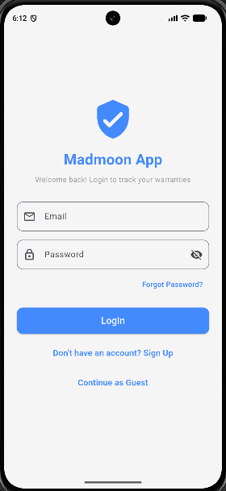
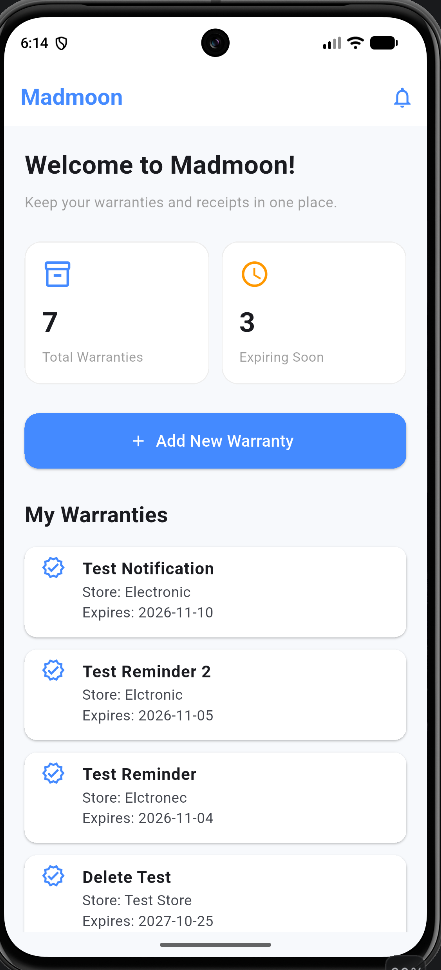

# Madmoon App
### Product Warranty and Receipt Management System

## Project Overview

Madmoon is a Flutter mobile application designed to help users organize product warranties, store purchase receipts, and track warranty expiration dates in one place.

The application helps users keep important purchase documents accessible and receive reminders before warranties expire.

## Key Features

- User registration and secure login using Supabase Authentication.
- Password recovery through email.
- Guest browsing mode.
- Add, view, edit, and delete product warranties.
- Upload and view purchase receipts and warranty cards.
- Support for JPG, PNG, and PDF attachments.
- Track warranty expiration dates.
- Local notifications 30, 7, and 1 day before warranty expiration.
- Dashboard showing total warranties and warranties expiring soon.
- User-specific data access through Supabase Row Level Security (RLS).

## Technologies Used

- **Flutter:** Cross-platform application development.
- **Dart:** Programming language.
- **Supabase Authentication:** User account management.
- **Supabase PostgreSQL:** Warranty data storage.
- **Supabase Storage:** Receipt and warranty document storage.
- **Flutter Local Notifications:** Warranty expiration reminders.
- **Android Studio:** Development and Android emulator testing.
- **GitHub:** Source code version control and sharing.

## Project Structure

- `lib/main.dart` — Application initialization and configuration.
- `lib/screens/` — User interface screens.
- `lib/services/notification_service.dart` — Local notification management.
- `android/` — Android platform configuration.
- `test/` — Flutter test files.
- `pubspec.yaml` — Project dependencies.
- `resources/` — Project documentation and screenshots, when added.

## Installation and Setup

### Requirements

- Flutter SDK
- Dart SDK
- Android Studio or Visual Studio Code
- Android emulator or compatible Android device
- A Supabase project

### Run the Application

1. Clone the repository:

   ```bash
   git clone https://github.com/mo506id/madmoon_app.git
   ```

2. Open the project directory:

   ```bash
   cd madmoon_app
   ```

3. Install dependencies:

   ```bash
   flutter pub get
   ```

4. Create a local file named `supabase_config.json` in the project root with your own Supabase project configuration:

   ```json
   {
     "SUPABASE_URL": "YOUR_SUPABASE_PROJECT_URL",
     "SUPABASE_PUBLISHABLE_KEY": "YOUR_SUPABASE_PUBLISHABLE_KEY"
   }
   ```

5. Run the application:

   ```bash
   flutter run --dart-define-from-file=supabase_config.json
   ```

**Security note:** The local Supabase configuration file is excluded from Git tracking. Never commit Supabase secret keys or service-role credentials.

## Testing

The project has been checked using:

```bash
flutter analyze
flutter test
```

The automated test currently provides a basic widget smoke test. Core application flows have also been manually tested using an Android emulator.

## Application Deployment Method

Madmoon has been developed and tested as a Flutter Android application using Android Studio and an Android emulator.

To generate an Android APK for installation, use:

```bash
flutter build apk --release --dart-define-from-file=supabase_config.json
```

A release APK can be found at:

```text
build/app/outputs/flutter-apk/app-release.apk
```

A release build must be generated and tested separately before being described as a completed production deployment.

## Resources

The `resources/` directory is intended for project screenshots, architecture diagrams, and other supporting documentation. These resources will be added separately.

## GitHub Repository

https://github.com/mo506id/madmoon_app

## Project Status

Academic project developed with Flutter and Supabase. Core functionality has been implemented and tested on an Android emulator.


## Application Screenshots

### Login Screen


### Dashboard
